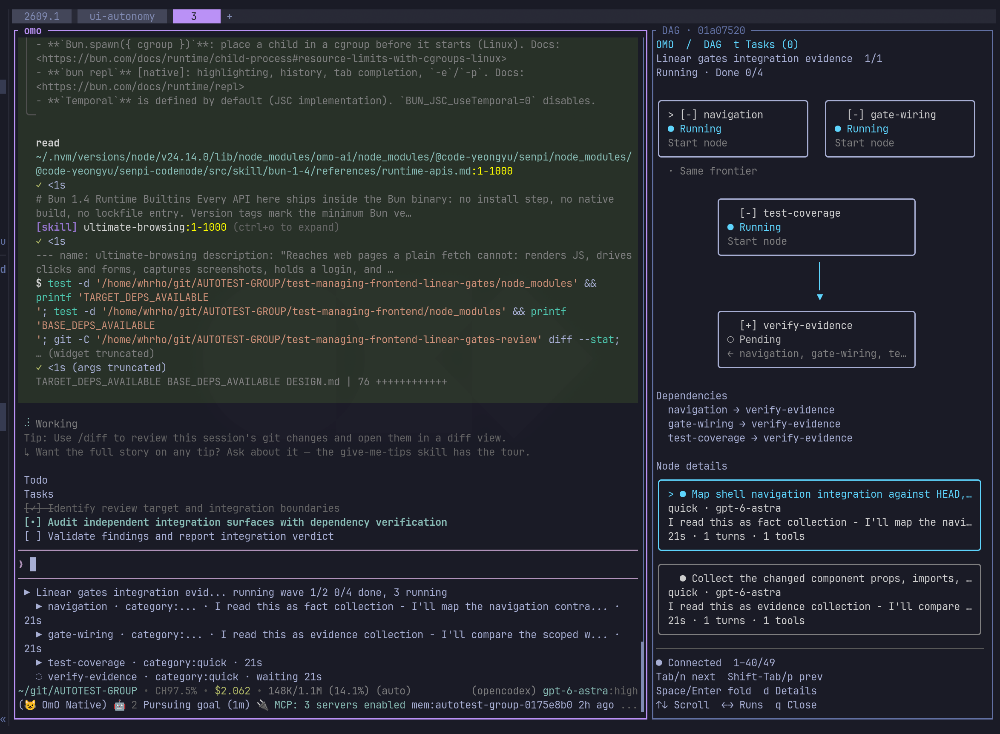
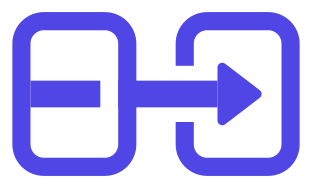
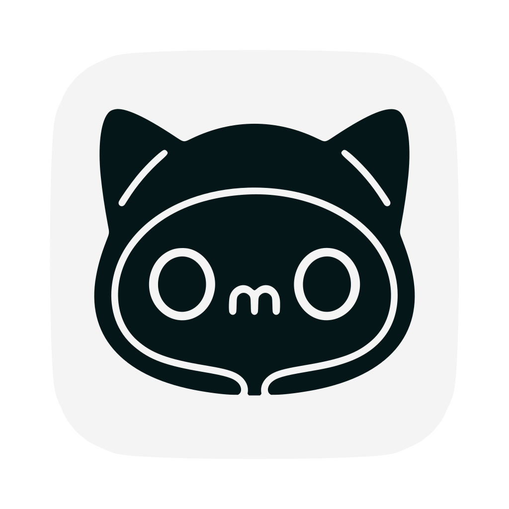

[English](README.md) | [简体中文](README.zh-cn.md) | [日本語](README.ja.md) | [Русский](README.ru.md) | [한국어](README.ko.md) | [Español](README.es.md) | [Français](README.fr.md) | [Deutsch](README.de.md) | [Português (Brasil)](README.pt-br.md) | [Italiano](README.it.md)

> [!NOTE]
> **OmO 5.0: OmO ❤️ Pi**
> Instale com `curl -fsSL https://get.omo.dev/install.sh | bash`. Sistema de memória, CodeMode, assinaturas da Anthropic, tudo incluso.
> [](https://github.com/jc01rho/omo-herdr-dag)
> *Basta digitar "mass ulw" com o seu prompt - agora você é o mestre da engenharia de grafos. O ultracode multimodelo, junto com um sistema de memória melhor. (O painel à direita é o [omo-herdr-dag](https://github.com/jc01rho/omo-herdr-dag).)*

> **Patrocinadores**
> Estes são os nossos patrocinadores. Eles ajudam a manter o OmO ativo como um projeto paralelo pessoal.
> | [](https://opengateway.ai/) | O **[OpenGateway](https://opengateway.ai/)** patrocina o OmO. Um gateway compatível com a OpenAI que reúne vários provedores de modelos em uma única API. Obrigado por apoiar o código aberto. |
> | :-----| :----- |


> [!NOTE]
>
> [](https://sisyphuslabs.ai)
> > **O OmO é mantido por Jobdori, o assistente de IA mostrado acima. Conheça seu próprio Jobdori, Dori. <br />Entre na lista de espera [aqui](https://sisyphuslabs.ai).**

> [!TIP]
> Junte-se a nós!
>
> | [](https://discord.gg/PUwSMR9XNk) | Entre na nossa [comunidade no Discord](https://discord.gg/PUwSMR9XNk) para se conectar com contribuidores e outros usuários do OmO. |
> | :-----| :----- |
> | [](https://x.com/justsisyphus) | As atualizações do OmO costumavam ser postadas na minha conta do X. <br /> Como ela foi suspensa por engano, [@justsisyphus](https://x.com/justsisyphus) agora posta atualizações em meu nome. |
> | [](https://github.com/code-yeongyu) | Siga [@code-yeongyu](https://github.com/code-yeongyu) no GitHub para mais projetos. |

<!-- <CENTERED SECTION FOR GITHUB DISPLAY> -->

<div align="center">

<a href="https://omo.dev"></a>

# OmO

**Sua ferramenta para trabalho de verdade. Mas é um agente.**

[](https://github.com/code-yeongyu/oh-my-openagent/releases)
[](https://omo.dev)
[](https://github.com/code-yeongyu/oh-my-openagent/graphs/contributors)
[](https://github.com/code-yeongyu/oh-my-openagent/stargazers)
[](https://github.com/code-yeongyu/oh-my-openagent/blob/dev/LICENSE.md)
[](https://omo.dev/docs)


</div>

<!-- </CENTERED SECTION FOR GITHUB DISPLAY> -->

O OmO é um único comando `omo` que transforma seus tokens em trabalho pronto: pesquisa em dez mil fontes, uma apresentação que as pessoas realmente entendem, backends, frontends, código. Ele roda no senpi, nosso fork do [pi](https://github.com/badlogic/pi-mono), com tudo o que está abaixo já integrado.

## Instalação

```bash
curl -fsSL https://get.omo.dev/install.sh | bash
omo
```

No Windows, no PowerShell: `irm https://get.omo.dev/install.ps1 | iex`. O script instala o binário nativo do `omo` para o seu SO e CPU em `~/.local/bin`, confere os checksums da versão e recorre ao GitHub Releases quando o espelho está inacessível. Adicione `-s -- beta` (ou uma versão como `-s -- 5.1.1`) após `bash` para escolher outro canal. O CMD do Windows, o ajuste do seu `PATH`, a atualização e a desinstalação são abordados em [omo.dev/docs/install](https://omo.dev/docs/install).

Prefere um gerenciador de pacotes? `bun add -g omo-ai` (ou `npm i -g omo-ai`) instala o mesmo OmO. O pacote é `omo-ai`; o pacote `omo` no npm não tem relação e pertence a outra pessoa.

Abra o seu projeto, execute `omo`, descreva a tarefa. Essa é toda a configuração.

Em uma sessão, `/thinking <level>` define o quanto o modelo pensa (`/thinking` sozinho abre um seletor), `Shift+Tab` alterna entre os níveis e `/efforts <level>` define o esforço de raciocínio diretamente em modelos com níveis de esforço. Para retomar um trabalho anterior, `/resume` (ou `/sessions`) abre suas sessões passadas; no shell, `omo -c` continua a última e `omo -r` abre o seletor. `/help` lista todo o resto.

Vindo da edição OpenCode ou do LazyCodex? Execute `omo setup` uma vez. Ele transfere suas chaves de provedor, provedores personalizados, servidores MCP, skills e escolhas de modelo. Em seguida, `omo doctor` mostra quais categorias de tarefas seus provedores podem executar e o que a instalação antiga deixou para trás. O passo a passo completo está em [Migrando do OpenCode](docs/guide/migrating-from-opencode.md).

Para atualizar, execute a linha de instalação novamente (uma instalação via gerenciador de pacotes atualiza com `omo update`). `rm ~/.local/bin/omo` remove a instalação do binário; `bun remove -g omo-ai` (ou `npm uninstall -g omo-ai`) remove a instalação do pacote.

## Por que o OmO

**ultrawork.** Pule o estudo. Se uma tarefa parecer difícil, adicione `ultrawork` (ou `ulw`) ao seu prompt. O agente lê a base de código antes de tocar em uma linha, planeja, comprova cada etapa antes de avançar, verifica o resultado na superfície real e para quando termina.

**Centenas de agentes, uma palavra-chave.** Digite `mass ulw` e todo o trabalho vira um grafo de agentes: pesquisa profunda em milhares de fontes, um pipeline completo de machine learning, uma migração que ninguém quer fazer. Cada parte roda no modelo mais adequado, em paralelo, e é verificada antes que qualquer coisa seja dada como pronta.

**Kibitzer. Seu agente não esquece de você, nem do seu trabalho.** A memória fica em um repositório git de arquivos markdown. Um modelo pequeno e barato fica ao lado do agente principal mais caro, lê o que você já fez e avisa o agente principal antes que ele repita um erro. Você para de se explicar repetidamente.

**Combine modelos sem pensar nisso.** Use os modelos de ponta que você adora junto com os mais baratos. Basta entrar: `/login` cobre assinaturas do Claude, ChatGPT, Kimi e GLM. Cada modelo já vem com um system prompt ajustado para ele, então você nunca escolhe o errado.

**Skills de alta qualidade, apenas as que você precisa.** Seu modelo é inteligente, mas ainda não sabe muito sobre como resolver problemas do mundo real. O OmO entrega o conhecimento que falta na forma de skills, incluindo uso do navegador, e carrega apenas o que a tarefa precisa.

**Todo o resto é pensado nos detalhes.** Chamadas de ferramentas independentes rodam juntas em um pequeno programa, então vinte leituras acontecem em uma única viagem de ida e volta. Argumentos de ferramentas malformados são reparados antes de rodar. Esperar por um build ou deploy funciona por inscrição, não por polling. Trabalhos longos mantêm um registro do que já foi verificado, para que uma sessão reiniciada continue de onde parou. Configurações, skills e prompts recarregam ao vivo.

## Configuração

Padrões opinativos, ajustáveis se você insistir. Suas configurações ficam em `~/.omo/omo.jsonc`, e um projeto pode adicionar seu próprio `.omo/omo.jsonc`; o arquivo mais próximo vence. Todas as chaves estão na [referência de configuração](docs/reference/configuration.md).

## Documentação

- [omo.dev/docs](https://omo.dev/docs)
- [Migrando do OpenCode](docs/guide/migrating-from-opencode.md)
- [Referência de configuração](docs/reference/configuration.md)
- [Recursos](docs/reference/features.md)
- [Uso do computador](docs/guide/computer-use.md) (experimental)
- [Manifesto Ultrawork](docs/manifesto.md)

## Avaliações

> "Me fez cancelar minha assinatura do Cursor. Coisas inacreditáveis estão acontecendo na comunidade open source." - [Arthur Guiot](https://x.com/arthur_guiot/status/2008736347092382053?s=20)

> "Se o Claude Code faz em 7 dias o que um humano faz em 3 meses, o OmO faz em 1 hora." <br/>- B, Pesquisador Quantitativo

> "Vocês deveriam integrar isso ao core e contratá-lo. Sério. É muito, muito, muito bom." <br/>- Henning Kilset

## Nota do Autor

Quando preciso tomar o volante de volta de um agente, isso não é trabalho em equipe. O sistema falhou. O OmO foi construído com base nessa ideia. Você diz o que quer; o agente pesquisa, planeja, escreve um código que você não conseguiria diferenciar do de um engenheiro sênior, faz a verificação e continua até terminar. Ele gasta tokens quando eles compram velocidade real e direciona as partes fáceis para modelos baratos.

Sou o usuário mais obcecado deste projeto. Qual modelo tem a lógica mais afiada? Quem escreve a melhor prosa? O que todo mundo lançou esta semana? O OmO é onde essas respostas vão parar. Tem um jeito melhor? PRs são bem-vindos.

O objetivo é um agente que você deixa de notar. Você aperta o interruptor, a luz acende. A versão longa está no [Manifesto Ultrawork](docs/manifesto.md).

Sem afiliação com nenhum projeto ou modelo mencionado. As ideias do Ultragoal e do UltraQA vêm do [oh-my-codex](https://github.com/Yeachan-Heo/oh-my-codex), reimplementadas a partir do conceito para o OmO.

## Amado por profissionais em

[Indent](https://indentcorp.com), criadores do Spray (solução de marketing de influência), vovushop (plataforma de comércio transfronteiriço) e vreview (solução de marketing de avaliações de comércio com IA). [Google](https://google.com). [Microsoft](https://microsoft.com). [Vercel](https://vercel.com). [ELESTYLE](https://elestyle.jp), criadores do elepay (gateway de pagamento multimóvel) e OneQR (SaaS de aplicativo móvel para soluções sem dinheiro em espécie). [Deepgram](https://deepgram.com).
